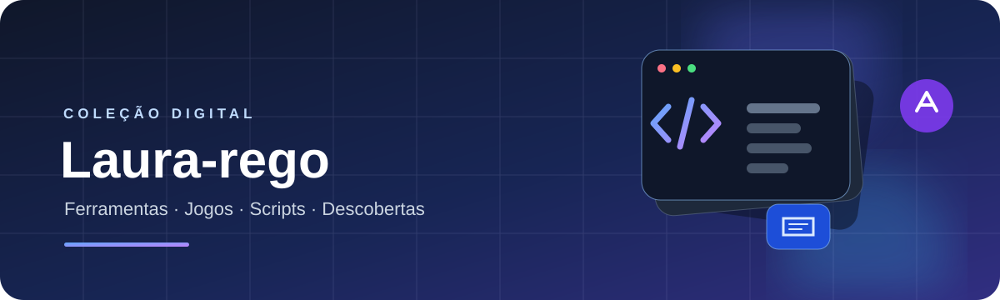

 

# ✨ Laura-rego

**Uma coleção pessoal de recursos digitais, ferramentas e descobertas da web.**

  
  

---

## 🧭 Explore o repositório

<table>
  <tr>
    <td width="50%">
      <h3>🤖 Ferramentas de IA</h3>
      Serviços online, assistentes e recursos para pesquisa e produtividade. 
      <a href="./Melhores%20IAs%20%F0%9F%A4%96.md">Abrir coleção →</a>
    </td>
    <td width="50%">
      <h3>🔎 Pesquisa e privacidade</h3>
      Buscadores e serviços com recursos voltados à privacidade. 
      <a href="./Pesquisa%20e%20privacidade.md">Abrir coleção →</a>
    </td>
  </tr>
  <tr>
    <td width="50%">
      <h3>🎮 Jogos e diversão</h3>
      Jogos de navegador, experiências e links interessantes. 
      <a href="./Sites%20divertidos%F0%9F%8E%AE.md">Abrir coleção →</a>
    </td>
    <td width="50%">
      <h3>🔗 Scripts e atalhos</h3>
      Bookmarklets, exemplos de JavaScript e personalizações. 
      <a href="./Scripts%F0%9F%94%97.md">Abrir coleção →</a>
    </td>
  </tr>
</table>

## 🔊 Mais uma seção

- [Guia de sons](./Sound%20botton%20guia%F0%9F%93%8B) — referências de efeitos sonoros e memes.

## 🌟 Sobre

Este repositório funciona como um catálogo pessoal: reúne links, ferramentas e pequenos experimentos em um só lugar. A ideia é manter tudo fácil de encontrar, consultar e atualizar.

## 📌 Avisos

- Links externos podem mudar ou deixar de funcionar.
- Ferramentas de terceiros têm seus próprios termos e políticas.
- Confira os recursos antes de utilizá-los.

---

**Feito por Lucca** · 2026

Organizado com curiosidade e um pouco de código 💙

